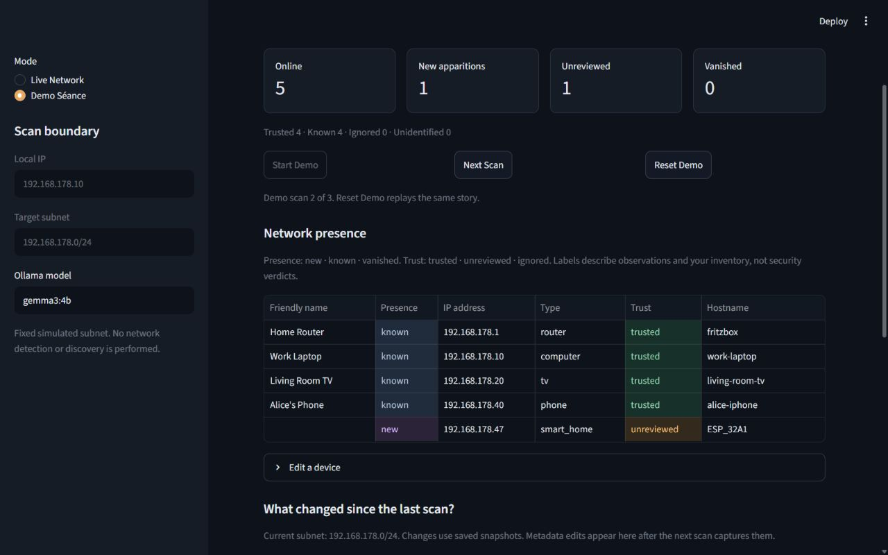
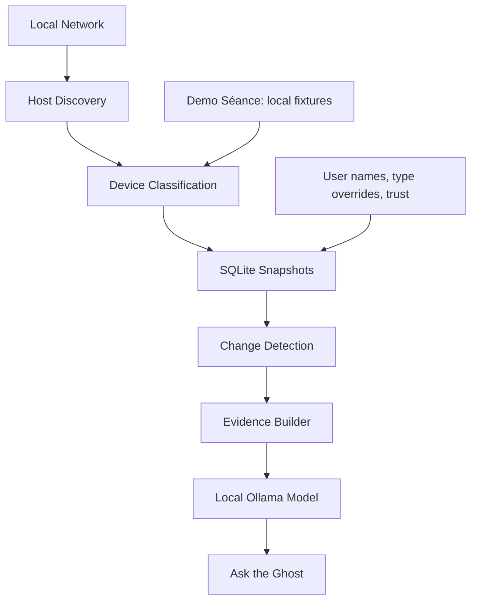
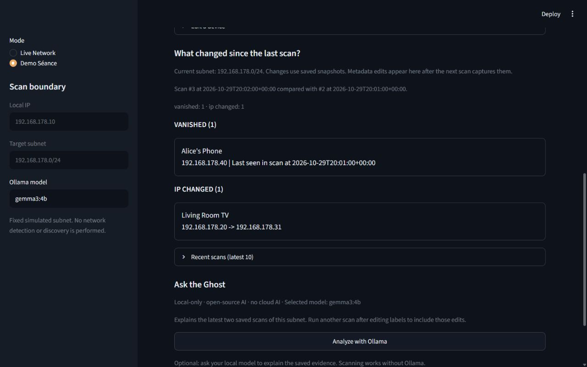

# SpecterLAN 👻

**Find the ghosts on your network.** SpecterLAN remembers device identities,
compares local network snapshots, and asks a local Ollama model to explain changes
using recorded evidence.



Product: **SpecterLAN**. Repository:
[rishabh-hasija/spectarlan](https://github.com/rishabh-hasija/spectarlan).

## Features

- Private IPv4 host discovery, capped at 256 addresses on the local subnet.
- MAC-based identity across IP changes, friendly names, type overrides, and trust labels.
- Deterministic classification with reasons; weak/conflicting evidence stays unknown.
- Immutable SQLite snapshots, recent scan history, and meaningful change detection.
- Optional **Ask the Ghost** reports with evidence references and confidence labels.
- **Demo Séance**: three isolated, repeatable stages without network discovery.

## Architecture



Demo skips discovery and reuses classification, metadata, storage, comparisons,
and evidence building. Each session owns a temporary SQLite database; resetting
Demo never touches live history.

## Why open innovation matters

Network inventories contain private names, addresses, vendors, and household
equipment. Evidence stays on the machine running SpecterLAN.
[Ollama](https://github.com/ollama/ollama) is the open-source inference runtime;
the default is **Gemma 3 4B** (`gemma3:4b`), a local open-weight model chosen
for broader local hardware compatibility. Its [model terms](https://ai.google.dev/gemma/terms)
are separate from SpecterLAN's MIT license.

Users can select `gemma4:e4b` or another compatible installed local Ollama model;
all inference remains local. No hosted AI provider, API key,
or paid API account is required. Prompts and evidence validation are inspectable,
and the project stays useful without dependence on one API vendor.
Scanning/history work without AI.

Initial dependency/model downloads require internet access. Scans use no internet
vendor lookups or cloud AI. Local inference works after downloading the model.
Discovery generates LAN traffic; fallback hostname resolution uses the OS resolver.
SQLite is not encrypted, and diagnostic server logs may contain private details.

## Requirements

- Python **3.11+**, Git, and a writable checkout.
- Streamlit **1.50+**, pandas, Pydantic, psutil, httpx, platformdirs (installed below).
- Live mode: an active private IPv4 interface and permission to discover hosts.
- Optional [Nmap](https://nmap.org/download.html) on PATH for richer observations.
- Optional [Ollama for Windows](https://ollama.com/download/windows), with enough
  RAM/VRAM for the selected model/context. Latency depends on hardware.

Windows PowerShell is the primary tested platform. Linux/macOS are not release
verified: fallback ping timeout flags vary across Unix systems, so prefer Nmap.
VPNs/virtual adapters can affect interface selection; check the sidebar boundary.

## Windows setup and run

```powershell
git clone https://github.com/rishabh-hasija/spectarlan.git
cd spectarlan
powershell -ExecutionPolicy Bypass -File setup_windows.ps1
powershell -ExecutionPolicy Bypass -File run_specterlan.ps1
```

Setup creates a local `.venv` and installs runtime dependencies. It never installs
Ollama or Nmap. Initial package/model downloads need internet access. No registration,
login, or email is required. Your history stays in `%LOCALAPPDATA%\SpecterLAN\`.

The launcher uses the checkout's virtual environment directly; activation is not
needed. Open the printed `http://127.0.0.1:8501` URL (or the port Streamlit reports).
Ctrl+C stops the app. The scripts work from another directory when invoked by
their full path, including paths with spaces. `ExecutionPolicy Bypass` applies
only to that PowerShell process; no persistent policy change is made.

If Python is not found, install Python 3.11+ and rerun setup. To select a specific
interpreter, pass `-Python 'C:\path\to\python.exe'`. Add `-Dev` to setup for pytest
and Ruff. `run_specterlan.ps1 -Check` checks the launcher environment without
starting Streamlit. Re-running setup updates Python dependencies in the existing
`.venv`; after moving a checkout, recreate `.venv` rather than copying it.

### First run

**Local setup and status** reports local storage, Python compatibility, Ollama,
the default `gemma3:4b` model, and Nmap. SpecterLAN automatically detects installed
local Ollama models. Choose another installed model from **Local AI model** in
the sidebar; arbitrary remote or invalid model names cannot be entered in the UI.
The preferred default is `gemma3:4b`, while a saved installed selection is preserved.
If that selection disappears, SpecterLAN prefers `gemma3:4b`, then the first suitable
installed model. Missing defaults are clearly identified. Without a suitable
installed model, Ask the Ghost is disabled; scanning and history still work.
Automatic fallbacks are not saved as user overrides. If the default becomes
available later, it is preferred unless you explicitly chose another valid model.

- **Storage problem:** Live mode stops with a permissions/free-space message.
  Demo Séance can still use its separate writable temporary storage.
- **Ollama unavailable or selected model missing:** scanning and history remain
  usable; Ask the Ghost is disabled with setup instructions. Ollama is needed
  only for Ask the Ghost. After installing and opening Ollama, run
  `ollama pull gemma3:4b`, then refresh the page after 15 seconds.
- **Nmap missing:** fallback discovery remains available. Nmap is recommended
  for richer observations, not mandatory.
- **No live network:** select Demo Séance for simulated evidence without discovery.

Checks do not download models, generate AI output, send inventory, or scan the
network. A ready model still needs sufficient memory and may take time to respond.

### Manual Python setup (advanced)

From the repository root:

```powershell
python -m venv .venv
.\.venv\Scripts\python.exe -m pip install -e ".[dev]"
.\.venv\Scripts\python.exe -m streamlit run app.py --server.address 127.0.0.1 --server.headless true --browser.gatherUsageStats false
```

Run from the repository root so `.streamlit/config.toml` loads the theme, hides
browser exception details, and suppresses Streamlit's onboarding email prompt.
This is a source-checkout application: installing its library wheel alone does
not install the top-level app or Streamlit configuration.

For runtime dependencies only, use `pip install -e .` with the environment's Python.
The `[dev]` extra adds pytest and Ruff. No cloud deployment is required.

### Executable packaging (future work)

A single executable is not part of this release. The supported route is a source
checkout with a local virtual environment. Bundling needs a separate Windows
validation pass for Streamlit's browser assets, package metadata, local server
startup, configuration, and subprocess discovery. A bundler would not include or
install Ollama, its model weights, or Nmap automatically. No PyInstaller bundle or
installer EXE has been added.

### Ollama setup

Install and open Ollama, then run:

```powershell
ollama pull gemma3:4b
ollama list
ollama run gemma3:4b "Reply with one short sentence."
```

If needed, launch the Ollama app or use `ollama serve` in another terminal.
Do not start a second server if one is already listening. Download/warm the model
before recording; SpecterLAN never downloads it. See the
[Ollama documentation](https://docs.ollama.com/quickstart).

Optional settings in the terminal used to launch SpecterLAN:

```powershell
$env:OLLAMA_URL="http://127.0.0.1:11434"
$env:OLLAMA_NUM_CTX="16384"
```

The dropdown supports `gemma4:e4b` after you explicitly run
`ollama pull gemma4:e4b`. SpecterLAN never downloads models automatically.
Valid selections are saved on this device. Discovery results refresh on a page
reload or rerun after the 15-second cache expires. Cloud and unverifiable models,
and models reported without chat capability, are excluded. All inference remains local.
`OLLAMA_MODEL` remains a model override for the Python analysis API; the UI uses
only its detected-model dropdown and saved selection.
`.env.example` is a reference;
**.env files are not automatically loaded**. Only loopback endpoints and locally
identifiable GGUF models are accepted; cloud/remote models are refused.
For server-side isolation, set `OLLAMA_NO_CLOUD=1` in Ollama's environment and
restart it ([local-only FAQ](https://docs.ollama.com/faq#how-do-i-disable-ollamas-cloud-features)).

### Nmap and fallback behavior

With Nmap on PATH, SpecterLAN runs `nmap -sn -oX - <subnet>`: host discovery,
without a port scan. On Windows, Nmap/Npcap installation and permissions affect
MAC/vendor visibility. Restart the terminal after changing PATH.

Without Nmap, discovery uses concurrent ping, the OS neighbor/ARP table, and
reverse hostname resolution. Vendors are unavailable in this fallback.
One failed host probe does not abort the subnet scan. An installed Nmap that
fails reports an error; it does not silently switch to ping. Sleeping devices,
firewalls, and isolation can cause missed hosts.

## Live Network

Live is the default. Select **Scan network** to find connected devices.
Open **Technical details** to check the network boundary and discovery method.
Broad interfaces are capped to the containing /24; public targets, unrelated
subnets, IPv6, and larger scans are refused.

The main table shows Device, Status, Type, Trust, and IP address. Names fall back
to the hostname or **Unknown device**, never a blank cell. Status labels are New,
Known, Offline, and Returned; trust labels are Trusted, Need review, and Ignored.
**Technical details** retains MAC addresses, hostnames, vendors, and automatic
classification reasons. **Edit a device** lets you name and review devices.
User types win over automatic suggestions. Trust labels are inventory labels, not
access controls; ignored devices stay visible.

**What changed since the last scan?** compares snapshots of the same subnet.
The first scan is a baseline. New, vanished, returning, IP, classification, and
metadata changes are shown. A same-MAC IP move is not a new device.
**Recent scans (latest 10)** limits the view, not stored history.

SpecterLAN does not operate a backend service and does not require registration.
Each installation stores its own network history locally on the device where it
runs. Two laptops on the same LAN keep independent SQLite databases and never
share history through SpecterLAN. There are no application accounts, logins,
Windows account-information collection, cloud sync, or application telemetry.
The bundled Streamlit configuration disables usage statistics and binds the UI
to loopback.

Live data uses the OS local application-data directory automatically:
`%LOCALAPPDATA%\SpecterLAN\specterlan.db` on Windows,
`~/Library/Application Support/SpecterLAN/specterlan.db` on macOS, or
`${XDG_DATA_HOME:-~/.local/share}/SpecterLAN/specterlan.db` on Linux.
The database holds scan history, friendly names, trust labels, classification
overrides, and the selected local model preference. The sidebar preserves a saved
selection only while it is installed and suitable. Missing or unsuitable preferences
are cleared after successful discovery; an Ollama outage preserves the saved choice.
No OS username, password, email, or account ID is requested or stored.

If the new database is absent, startup imports `.specterlan.db` from the working
directory using a SQLite backup, leaving the original intact. An existing new
database is never replaced or merged. Schema migrations preserve historical
scans. Stop the app before upgrading or backing up its database. Metadata edits
enter history/comparisons after another scan; historical values remain unchanged.

No usable MAC means provisional subnet/IP identity. Reused IPs can inherit
provisional labels; IP moves cannot safely be linked. Randomized MACs can split
one physical device into several identities. Hostnames/vendors are hints.
See the [behavior reference](docs/BEHAVIOR.md) for rules, migrations, and AI validation.

## Demo Séance

Select **Demo Séance**; keep its **simulated network evidence** banner visible.
No live interface detection or discovery runs.

1. **Start Demo**: known/trusted router, laptop, TV, phone.
2. **Next Scan**: new/unreviewed `ESP_32A1`, Espressif, at `192.168.178.47`.
   Effective type is `smart_home` via a normal saved override. Automatic type
   stays unknown because ESP/vendor evidence alone is weak.
3. **Next Scan**: TV keeps its MAC, moves .20 → .31; phone vanishes; ESP remains.
4. **Reset Demo** discards only this session's simulated history/edits and replays.

Fixtures have fixed timestamps, MACs, and observations. The session's temporary
database is cleaned up when released/process exits; forced termination may
leave an OS temporary folder. Live history stays separate. Progress ends at
scan 3. Model wording/latency are not deterministic.



### 60-second demo sequence

Download/warm the model, check a real analysis succeeds, reset Demo, and rehearse.
Inference may exceed this schedule (default timeout: 180 seconds). Disclose an
edited waiting interval if needed.

| Time | Action |
| --- | --- |
| 0–5s | Open Demo Séance; show the simulated-evidence banner. |
| 5–12s | Start Demo; show known/trusted baseline and device types. |
| 12–22s | Next Scan; highlight new/unreviewed ESP_32A1. |
| 22–32s | Show “What changed since the last scan?” and its comparison. |
| 32–45s | Run Ask the Ghost with the installed local model. |
| 45–53s | Show its explanation, model name, and cited evidence. |
| 53–60s | Next Scan; show the TV IP move and vanished phone. |

End with: **Local network evidence. Local model. No cloud AI.**

## Ask the Ghost

After a saved scan, select **Analyze with Ollama**. Only the latest and preceding
saved scans of this subnet are supplied. The report shows overview, notable
changes, devices to verify, suggested manual checks, and evidence. The actual
returned model and snapshot IDs are visible.

Strict JSON validation and evidence checks reject unsupported content. Short
`E1`, `E2`, … citations are constrained to the supplied evidence IDs. One local
correction retry can repair invalid references; if only part of a response passes
the checks, SpecterLAN shows that part with a notice. It never invents supporting
evidence or accepts unknown IDs. If too little is grounded, a specific verification
message appears while scan data stays unchanged.
The model reads a flat, labeled evidence list. Device reviews cite saved observations;
SpecterLAN resolves their identities locally, including provisional/no-MAC devices.
An unsupported observation is omitted while independently grounded findings remain
visible. Local developer diagnostics expose only counts and citation IDs.
Offline Ollama, missing models, timeouts, or invalid output leave scanning/history
available. Confidence describes evidence support, not risk. Models can still
misinterpret valid citations; check the facts. Oversized evidence fails clearly
rather than dropping devices. Increase `OLLAMA_NUM_CTX` only if hardware/model support it.

## Safety boundaries and limitations

- Use only on networks you own or administer.
- Host discovery only: no exploitation, credential attacks, port scanning,
  service fingerprinting, vulnerability scanning, or automatic remediation.
- Unknown/new does not mean malicious. Vanished means absent from the latest
  scan. AI output is explanatory, **not a security verdict**.
- No authentication: keep the UI on loopback as in the run command.
- Discovery is incomplete; missing/randomized MACs and ambiguous names limit results.
- Historical records are immutable; there is no audit of every edit between scans.
- Tests mock Ollama and discovery. They do not establish real-model accuracy,
  hardware performance, or live-network completeness.

## Tests and release checks

```powershell
.\.venv\Scripts\python.exe -m pytest -q
.\.venv\Scripts\python.exe -m ruff check .
```

No running model or live scan is required for tests.
Use the [release checklist](docs/RELEASE_CHECKLIST.md) for install/manual checks,
privacy review, and submission readiness.

## Project structure

```text
app.py                       Streamlit flow and mode controls
setup_windows.ps1            Local virtual environment and dependency setup
run_specterlan.ps1           Windows launcher and dependency preflight
.streamlit/config.toml       Theme, loopback binding, and privacy settings
specterlan/
  network.py                 Host discovery and boundaries
  classification.py          Deterministic local rules
  models.py                  Device, snapshot, AI response models
  store.py                   SQLite snapshots, metadata, migrations
  storage_paths.py           OS local app data and legacy database import
  readiness.py, readiness_ui.py  Local prerequisite checks and first-run status
  changes.py                 Snapshot comparison
  evidence.py                Two-scan fact catalog
  ai.py                      Local Ollama client and validation
  demo.py                    Isolated deterministic fixtures
  ui.py, history_ui.py,
  ai_ui.py, style.css         Presentation
tests/                       Mocked unit and Streamlit flow tests
docs/                        Behavior, release, submission, screenshots
```

## Hacktoberfest context

Prepared for the [Hacktoberfest Open-Source AI Challenge: Week 4](https://dev.to/events/challenges/hacktoberfest-week4-2026-10-26),
“Ghost in the Machine.” The [submission draft](docs/HACKTOBERFEST_SUBMISSION.md)
needs the recorded video and maintainer review. This is not a published entry
or a claim of eligibility.

## Project licensing

SpecterLAN is open-source software under the [MIT License](LICENSE).
Dependencies and models retain their own licenses/terms, including the separate
Gemma model terms linked above.
